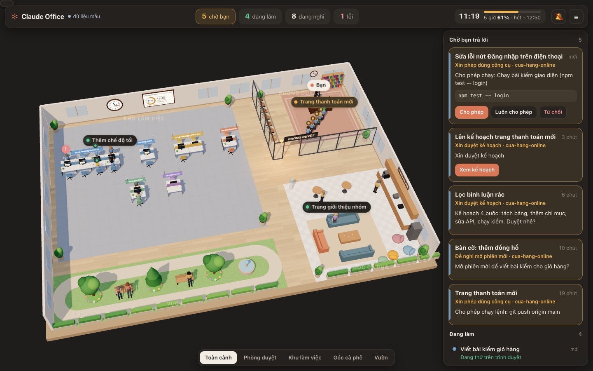
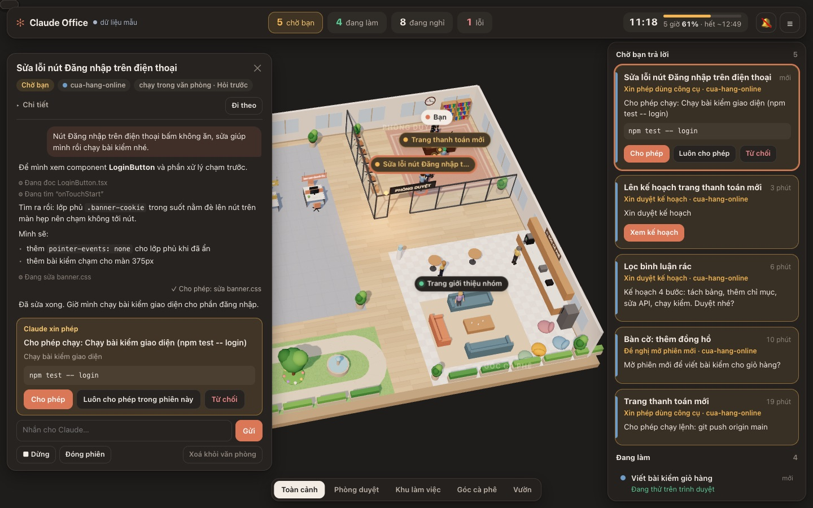

# Claude Office

Văn phòng 3D cho các phiên Claude Code trên máy Mac: mỗi phiên là một người.

## Cài nhanh: nhờ Claude cài giúp

Mở Claude Code (thẻ **Code** trong app Claude, hoặc gõ `claude` trong Terminal) rồi dán câu này:

```text
Cài giúp tôi Claude Office theo mục "Cài từ đầu tới cuối" trong README ở https://github.com/TrungHai0230396/claude-office
```

- Claude hỏi bạn chọn chế độ: **chỉ xem** (trả lời trong app Claude như thường) hay **điều khiển qua web** (giao
  việc, chat, cho phép ngay trên trang). Claude xin phép chạy từng lệnh thì cứ cho phép.
- Chỉ xem: cài xong là dùng. Điều khiển qua web: tới bước đăng nhập (`/login`) và cấp quyền macOS thì Claude dừng
  lại chỉ bạn làm.
- Xong thì mở <http://127.0.0.1:5230>. Cần macOS, Claude Code; Node 18+ và git thì Claude giúp cài nếu thiếu.

> **Dành cho Claude (hay AI) đang đọc README này để cài:** làm đúng thứ tự mục
> [Cài từ đầu tới cuối](#cài-từ-đầu-tới-cuối) bên dưới, mỗi bước kiểm xong mới sang bước sau. Hỏi người dùng
> muốn chế độ nào (điều khiển qua web, hay chỉ xem và trả lời trong app Claude desktop như ban đầu) trước bước 4.
> Chế độ chỉ xem xong ở bước 5, **không cần** đăng nhập hay cấp quyền gì thêm. Chế độ điều khiển qua web thì bước
> đăng nhập Claude Code (`/login`) và cấp quyền macOS là việc của người dùng — tới đó thì dừng lại nhờ họ làm.
> Bot Telegram (tuỳ chọn, bước 9): người dùng tự tạo bot và tự cất token vào Keychain; **không bao giờ** xin hay
> nhận token bot qua chat.

> **English.** *Claude Office* is a local 3D dashboard for the Claude desktop app's
> Code sessions and Claude Code CLI sessions on macOS. Every session is a worker: running sessions type at
> their project's desk, sessions waiting on you (permission prompt, question, plan approval, "shall I push?")
> queue in a glass approval room in front of your desk, finished ones get coffee or walk in the garden. A wall
> clock and a usage board show the 5-hour limit. It runs on `127.0.0.1`; for the app's sessions it only reads
> local files. Two modes: **web control** (default) lets you start sessions from the office itself (Claude
> Agent SDK, using your own Claude Code sign-in: Pro/Max plan or API key) and chat, allow tools, answer
> questions and approve plans right there; **view-only** (`npm run cai-chi-xem`) keeps the original behaviour —
> you answer in the Claude desktop app, and new tasks open there. In web-control mode an optional **private
> Telegram bot** (your own, made with @BotFather; token kept in the macOS Keychain) pings you when a session needs
> you and lets you approve, answer, pick the model/effort and start tasks from your phone without the 3D page.
> The UI is in Vietnamese. Unofficial, not affiliated with Anthropic.
> **Installing with an AI agent?** Follow [Cài từ đầu tới cuối](#cài-từ-đầu-tới-cuối) step by step; in web-control
> mode the sign-in and macOS permission steps must be done by the user (view-only mode needs neither), and so is
> creating the Telegram bot and storing its token — never ask for the token in chat.



> **Lưu ý.** Đây là dự án cá nhân, **không chính thức**, không liên quan tới Anthropic ("Claude" là thương
> hiệu của Anthropic). Trang đọc các tệp nội bộ chưa công bố của app Claude và Claude Code (định dạng có thể
> đổi bất cứ lúc nào khi app cập nhật), chỉ đọc chứ không ghi hay gửi đi đâu. Phần giao việc trong văn phòng
> (tuỳ chọn) chạy bản Claude Code nguyên gốc qua [Claude Agent SDK](https://code.claude.com/docs/en/agent-sdk/overview)
> của Anthropic, bằng đăng nhập Claude Code của chính bạn. Hiện chỉ chạy trên macOS.

| Phiên đang… | Người trong văn phòng |
|---|---|
| chạy (đang nghĩ, chạy lệnh, sửa mã, đọc tệp, lướt web, thử trình duyệt) | ngồi bàn của dự án mình, gõ phím; màn hình đổi theo việc; có trợ lý con thì robot nhỏ bay quanh bàn |
| chờ bạn: xin quyền dùng công cụ, hỏi bạn, trình kế hoạch, đề nghị mở phiên mới, hỏi "commit/push không?", nộp bài chờ xem | ôm tờ trình sang **phòng duyệt**, xếp hàng trước bàn sếp (là bạn); chờ quá 1 giờ thì ngồi ghế chờ; đèn trên cửa nhấp nháy |
| vừa xong lượt | vươn vai, đi pha cà phê, rồi đứng bàn cao, ngồi sofa tán gẫu, dạo vườn, ngồi ghế đá |
| lỗi (hết lượt dùng, đầy ổ đĩa, lỗi API…) | ngồi ôm đầu trước màn hình đỏ |
| hơn 8 giờ không có việc | gục bàn ngủ |

Được duyệt xong (phiên chạy tiếp) thì sếp đóng dấu "ĐÃ DUYỆT" và người đó quay về bàn.

Muốn sai người đi đâu thì nhắn phiên một câu ngắn: "đi ngồi công viên", "đi ra lấy cf", "đi dạo vườn",
"ra sofa", "đi uống nước", "ra bàn cao tán gẫu", "vô ghế làm việc". Xong lượt, người đó tới đúng chỗ và ở
yên đó (lấy cà phê thì pha xong ra bàn cao đứng uống) tới khi bạn nhờ việc khác.

Trang chỉ làm nổi việc cần bạn, phần còn lại để chìm cho đỡ rối mắt:

- **Bảng bên**: "Chờ bạn trả lời" là thẻ to (câu hỏi, đã chờ bao lâu, nút **Mở để trả lời** mở đúng
  phiên trong app Claude qua `claude://claude.ai/epitaxy/<mã phiên>`; phiên chạy trong văn phòng thì có
  luôn nút **Cho phép / Từ chối**); "Đang làm" mỗi người một dòng; "Đang nghỉ" và "Gặp lỗi" gập sẵn.
  Bấm một thẻ hay một dòng thì dưới chân người đó hiện vòng sáng.
- **Trong cảnh** chỉ người đứng đầu hàng chờ và người đang làm có nhãn tên; người chờ sau là chấm vàng,
  lỗi mới là chấm đỏ, người nghỉ không có nhãn. Rê chuột vào ai cũng hiện ô gợi ý.
- **Thông báo** chỉ bật khi có người mới xin duyệt hay vừa gặp lỗi; nút 🔔 bật thêm chuông và thông báo
  của máy.
- Giao diện theo chủ đề sáng/tối của máy (tối thì văn phòng lên đèn buổi tối).
- **Máy quay như xem bản đồ**: kéo chuột (một ngón) để dời cảnh, lăn chuột (chụm hai ngón) để phóng to/thu
  nhỏ, kéo chuột phải (xoay hai ngón) để xoay góc nhìn. Mặc định nhìn một hướng cố định (màn dọc thì nhìn từ
  phía tây cho văn phòng nằm dọc); nút **Toàn cảnh** đưa về hướng đó, các nút góc nhìn khác trượt và phóng tới
  khu đó. Chọn ai thì máy quay đứng yên, dưới chân người đó hiện vòng sáng; người đó nằm ngoài màn hình thì cảnh
  chỉ trượt ngang tới, giữ nguyên độ xa. Gập/mở bảng bên chỉ dịch cảnh sang ngang. Tải lại trang vẫn giữ góc nhìn.

## Cài từ đầu tới cuối

Cho người mới và cho phiên Claude khác làm giúp. Chạy lần lượt trong Terminal, mỗi bước kiểm xong mới sang bước sau.

1. **Kiểm máy**: macOS; git; Claude Code dòng lệnh (`claude --version`, chưa có thì cài theo
   <https://code.claude.com/docs/en/setup>); **Node 18 trở lên** (`node -v`). Node thấp hơn thì đổi trước khi
   làm tiếp: có nvm thì `nvm ls` rồi `nvm use <bản 18+ đã cài>` (chưa có thì `nvm install --lts`); không có nvm
   thì cài Node LTS ở <https://nodejs.org> hoặc `brew install node`.
   *Phiên Claude làm giúp:* mỗi lệnh shell chạy trong một shell mới nên `nvm use` không giữ lại — ghép nó vào
   đầu mọi lệnh ở bước 2–4, ví dụ `source ~/.nvm/nvm.sh && nvm use 24 && npm ci`.
2. **Lấy mã và cài thư viện** (Claude Agent SDK, khoảng 300 MB):

   ```bash
   cd ~ && git clone https://github.com/TrungHai0230396/claude-office.git && cd claude-office && npm ci
   ```

   Đã có thư mục `~/claude-office` từ trước thì thay bằng `cd ~/claude-office && git pull && npm ci`.
3. **Kiểm mã**: `npm test` — mọi bài phải qua (`pass`, `fail 0`). Báo `node: bad option: --test` nghĩa là đang
   chạy bằng Node cũ (quay lại bước 1).
4. **Chọn chế độ rồi cài chạy nền** (tự bật mỗi khi đăng nhập máy):
   - **Điều khiển qua web** — giao việc, chat, cho phép, duyệt ngay trên trang: `npm run cai-tu-chay`
   - **Chỉ xem như ban đầu** — trả lời và cho phép trong app Claude desktop, nút Giao việc mở việc mới trong
     app: `npm run cai-chi-xem`

   Lệnh in ra dòng `Claude Office đang chạy nền: http://127.0.0.1:5230 (node: …)` — bản chạy nền tự chọn Node
   mới nhất cài qua nvm (không có nvm thì lấy `node` trong PATH), không phụ thuộc Node mặc định. Kiểm: `curl -s http://127.0.0.1:5230/api/trang-thai | head -c 120`
   phải in ra JSON bắt đầu bằng `{"phien":`. (Chỉ muốn chạy tạm thì `npm start`, hay `VPC_DIEU_KHIEN=0 npm start`
   cho chế độ chỉ xem.)
5. **Mở** <http://127.0.0.1:5230>. Xem thử với dữ liệu mẫu: <http://127.0.0.1:5230/?demo>.
   **Chế độ chỉ xem thì xong ở đây** — không cần `/login` hay cấp quyền ổ đĩa (văn phòng chỉ đọc tệp trên máy;
   trả lời và chạy việc trong app Claude desktop, vốn đã đăng nhập sẵn).
6. **Chế độ điều khiển qua web — đăng nhập Claude Code, người dùng tự làm**: chạy `claude`, gõ `/login`, chọn
   đăng nhập bằng tài khoản Claude có gói (Pro/Max/Team) — hay API key nếu muốn tính tiền theo API. Văn phòng dùng
   đúng đăng nhập này (xem mục [Đăng nhập](#đăng-nhập-dùng-gói-claude-của-bạn)).
7. **Chế độ điều khiển qua web, dự án nằm trong Documents, Desktop hay Downloads — người dùng tự làm**: cấp
   "Truy cập toàn bộ ổ đĩa" cho `node` mà bước 4 in ra, rồi chạy lại `npm run cai-tu-chay`; hoặc bỏ chạy nền
   (`npm run go-tu-chay`) và dùng `npm start` trong Terminal (xem [mục này](#macos-chặn-thư-mục-documents-desktop-downloads)).
   Kiểm: bấm **＋ Giao việc**, chọn một dự án, giao một việc nhỏ; Claude xin quyền thì bấm **Cho phép**.
8. **Về sau**: cập nhật `git pull && npm ci && npm run cai-tu-chay` (chế độ chỉ xem thì `npm run cai-chi-xem`);
   đổi chế độ thì chạy lệnh cài của chế độ kia; gỡ hẳn `npm run go-tu-chay`.
9. **Tuỳ chọn, chế độ điều khiển qua web — bot Telegram, người dùng tự làm**: làm theo mục
   [Nối bot](#nối-bot-người-dùng-tự-làm-khoảng-3-phút). *Phiên Claude làm giúp:* chỉ đưa người dùng lệnh
   `security add-generic-password …` để họ tự dán token trong Terminal của họ, **không** xin token qua chat; kiểm
   bằng hộp 📱 trên trang (báo "Bot @… đã sẵn sàng" là văn phòng đã nhận token).

## Chạy

Cần macOS, Node 18 trở lên, và app Claude (thẻ Code) hay Claude Code trên cùng máy.

```bash
git clone https://github.com/TrungHai0230396/claude-office.git
cd claude-office && npm install && npm start
```

Rồi mở <http://127.0.0.1:5230>. three.js r152 nằm sẵn trong `public/vendor/`; `npm install` chỉ để cài
Claude Agent SDK cho phần giao việc (không cài thì phần xem vẫn chạy). Muốn xem thử với dữ liệu mẫu:
<http://127.0.0.1:5230/?demo> (thêm `&chon=vp_demo_dang_nhap` để mở sẵn khung chat mẫu). Đổi cổng:
`PORT=5300 npm start`.

Máy chủ chỉ nghe `127.0.0.1` và từ chối yêu cầu có `Host` khác localhost. Với phiên của app Claude, nó
chỉ **đọc** tệp, không ghi, không gửi gì ra ngoài.

### Chạy nền tự động

```bash
npm run cai-tu-chay
```

Chép mã sang `~/Library/Application Support/ClaudeOffice/app` (macOS chặn tiến trình nền đọc
`~/Documents`) và đăng ký LaunchAgent `com.claudeoffice.server`: bật mỗi khi đăng nhập, tự bật lại nếu
bị tắt. Nhật ký ở `~/Library/Logs/ClaudeOffice/server.log`. **Sửa mã xong thì chạy lại lệnh này** để
bản chạy nền dùng mã mới. Gỡ hẳn: `npm run go-tu-chay`.

## Giao việc ngay trong văn phòng

Nút **＋ Giao việc** trên thanh trên: chọn dự án, ghi việc, rồi chọn **chạy ở đâu**:

- **Trong văn phòng** (chế độ điều khiển qua web): máy chủ chạy một phiên Claude Code mới qua
  [Claude Agent SDK](https://code.claude.com/docs/en/agent-sdk/overview); chọn Claude được tự làm tới đâu
  (**Hỏi trước** / **Tự sửa tệp** / **Tự động** — Claude Code tự duyệt việc an toàn, chỉ hỏi việc rủi ro /
  **Lên kế hoạch trước**; đổi được giữa chừng ở ô **Chế độ** dưới khung chat), chọn **model** (danh sách lấy từ
  Claude Code, như `/model`: Opus, Fable, Sonnet, Haiku và các bản cũ hơn) và **effort** (low … max; để
  **Mặc định** thì Claude Code tự chọn theo model, ô chọn ghi rõ mức, vd. medium với Opus 5.5). Mọi thứ trả lời
  ngay trên trang.
- **Mở trong app Claude** (như ban đầu, có ở cả chế độ chỉ xem): trang mở app Claude desktop bằng link
  `claude://code/new?q=<việc>&folder=<thư mục>` — giống mục "New Claude Code Session Here" của Finder — để bạn
  xem lại rồi chạy trong app; phiên hiện trong văn phòng như mọi phiên của app, trả lời bằng nút **Mở để trả lời**.

Người đó vào bàn làm việc như mọi phiên khác. Với phiên chạy trong văn phòng, bấm vào người đó là thẻ chi tiết
thành **khung chat**:

- nhắn tiếp (Enter gửi, Shift+Enter xuống dòng), kèm **ảnh hay tệp** (📎, dán hay kéo thả: ảnh Claude xem trực
  tiếp, tệp khác lưu vào thư mục riêng của văn phòng rồi Claude đọc), **nói thay gõ** (🎤, tiếng Việt, cần trình
  duyệt hỗ trợ đọc chính tả); **Dừng** giữa chừng, **Đóng phiên**, **Xoá khỏi văn phòng**;
- đổi **Chế độ**, **Model**, **Effort** ngay giữa phiên (có hiệu lực từ câu trả lời sau);
- Claude **xin quyền** (chạy lệnh, sửa tệp…) thì hiện lệnh đầy đủ và ba nút **Cho phép** / **Luôn cho phép
  trong phiên này** / **Từ chối** — bấm được luôn trên thẻ ở bảng bên;
- Claude **hỏi bạn** (AskUserQuestion) thì hiện các lựa chọn để bấm, hoặc tự gõ câu trả lời;
- Claude **trình kế hoạch** thì đọc ngay trong thẻ, **Duyệt** (hỏi trước khi sửa tệp, hay cho tự sửa tệp)
  hoặc ghi góp ý để Claude sửa lại.



Phiên rảnh 30 phút thì tiến trình tự tắt cho nhẹ máy; nhắn tiếp là chạy lại từ chỗ cũ. Danh sách phiên lưu
ở `~/Library/Application Support/ClaudeOffice/phien-van-phong.json` (không lưu hội thoại; hội thoại nằm
trong nhật ký của Claude Code như mọi phiên). Phiên của app Claude desktop vẫn chỉ xem và mở trong app.

### Đăng nhập: dùng gói Claude của bạn

Phiên chạy trong văn phòng là bản Claude Code nguyên gốc (SDK chạy đúng tệp `claude` Anthropic phát hành) và
dùng **đúng đăng nhập Claude Code trên máy** — chung với lệnh `claude` trong Terminal, **không** phải đăng nhập
của app Claude desktop. Đăng nhập bằng gói Pro/Max thì phiên tính vào hạn mức của gói như mọi phiên Claude
Code khác; đăng nhập bằng API key thì tính tiền theo API.

- Đăng nhập hay đổi tài khoản: mở Terminal, chạy `claude`, gõ `/login`, chọn tài khoản Claude có gói. Việc đăng
  nhập luôn đi qua trang của Anthropic; văn phòng **không** đọc, lưu hay chuyển token.
- Xem phiên đang dùng tài khoản nào: khung chat → **Chi tiết → Đăng nhập**.
- Gặp lỗi *This organization has been disabled*: Claude Code đang đăng nhập vào một tổ chức (tài khoản Console)
  đã bị khoá — `/login` lại bằng tài khoản Claude có gói.

Theo trang [Legal and compliance](https://code.claude.com/docs/en/legal-and-compliance) của Claude Code, hạn mức
Pro/Max tính cho việc dùng cá nhân Claude Code và Agent SDK, và người dùng được đăng nhập bản Claude Code nguyên
gốc bằng gói của chính mình. Điều bị cấm là ứng dụng bên thứ ba tự làm màn đăng nhập Claude.ai, thu hay giữ
token, hoặc dùng gói của người này chạy việc cho người khác — nên mỗi người tự cài văn phòng trên máy mình, với
tài khoản của mình.

### Khoá máy chủ thế nào

Trang văn phòng ra lệnh được cho Claude chạy trên máy bạn, nên máy chủ chỉ nhận lệnh khi đủ cả
(`lib/bao-ve.js`, có bài kiểm):

- `Host` là `127.0.0.1` / `localhost` (chặn trang lạ dùng DNS rebinding);
- `Origin` đúng trang văn phòng, thân lệnh là JSON (trang web khác không gửi lệnh tới được);
- kèm **mã bí mật** tạo ngẫu nhiên mỗi lần máy chủ khởi động, chỉ nằm trong trang văn phòng do máy chủ trả
  về (không có CORS nên trang khác không đọc được); trang có `X-Frame-Options: DENY` để không bị nhúng vào
  khung lừa bấm;
- thư mục giao việc phải có thật, nằm **trong thư mục nhà** (đã giải liên kết mềm);
- **không bao giờ** chạy chế độ bỏ qua quyền: chỉ `default`, `acceptEdits`, `auto`, `plan`; nút "Luôn cho phép" chỉ
  có hiệu lực **trong phiên đó** (không ghi vào tệp cài đặt nào) và lọc bỏ mọi gợi ý đổi sang chế độ bỏ qua
  quyền; phiên lỡ bị đổi sang chế độ khác thì bị kéo về `default`;
- mỗi lời xin quyền chỉ được trả lời bằng **cú bấm của bạn**; không có gì tự cho phép.

Lưu ý: `127.0.0.1` mở được từ **mọi tài khoản trên cùng máy Mac**. Máy dùng chung nhiều tài khoản thì dùng chế
độ chỉ xem: `npm run cai-chi-xem` (chạy tạm: `VPC_DIEU_KHIEN=0 npm start`); khi đó trang không nhận lệnh nào,
chỉ xem và mở app Claude như ban đầu.

Phiên chạy trong văn phòng nạp cài đặt, CLAUDE.md, hook và MCP của bạn giống hệt khi chạy `claude` trong
thư mục đó.

### macOS chặn thư mục Documents, Desktop, Downloads

Bản chạy nền (LaunchAgent) không được macOS cho vào `~/Documents`, `~/Desktop`, `~/Downloads` nếu chưa cấp
quyền, nên giao việc cho dự án ở đó sẽ báo lỗi kèm cách làm. Hai cách:

- Cài đặt hệ thống → Quyền riêng tư & Bảo mật → **Truy cập toàn bộ ổ đĩa** → thêm đúng tệp `node` mà máy chủ
  dùng (lệnh `npm run cai-tu-chay` in ra đường dẫn), rồi chạy lại `npm run cai-tu-chay`. Lưu ý: mọi chương
  trình chạy bằng `node` đó đều có quyền này.
- Hoặc không chạy nền (`npm run go-tu-chay`) mà chạy `npm start` từ Terminal.

## Dùng trên điện thoại

- **Chỉ cần trả lời phiên của app Claude**: dùng app **Claude** trên điện thoại (mục **Code**). Bật "Connect new
  sessions to Remote Control" trong app Claude desktop (Settings → Claude Code) thì các phiên trên Mac hiện trên
  điện thoại, nhắn tiếp và cho phép được ở đó (gói Team/Enterprise cần người quản trị bật Remote Control).
- **Mở cả văn phòng 3D** (xem, giao việc, chat, duyệt): qua **Tailscale** — mạng riêng, mã hoá, chỉ máy của bạn.
  1. Cài Tailscale trên Mac và điện thoại, đăng nhập cùng một tài khoản.
  2. Trên Mac chạy `tailscale serve --bg 5230` (lần đầu Tailscale có thể nhờ bật HTTPS cho mạng của bạn — bấm
     link nó in ra). Lệnh in ra địa chỉ dạng `https://<tên-máy>.<tên-mạng>.ts.net`.
  3. Mở địa chỉ đó trên điện thoại (đang bật Tailscale).

  Máy chủ vẫn chỉ nghe `127.0.0.1`; yêu cầu đi qua `tailscale serve` chỉ được nhận khi Tailscale báo đúng là
  **tài khoản chủ máy** (người khác trong cùng mạng Tailscale cũng không vào được), lệnh vẫn cần mã bí mật và
  đúng Origin (`lib/tu-xa.js`). **Đừng** dùng `tailscale funnel` (mở ra Internet) hay mở cổng ra Wi-Fi chung: ai
  vào được trang này là ra lệnh được cho Claude trên máy bạn. Tắt: `tailscale serve --https=443 off`.

  Thêm vào màn hình chính (Safari → Chia sẻ → **Thêm vào MH chính**) thì có biểu tượng **Văn phòng** mở như app.
- **Không mở 3D, chỉ cần báo và bấm duyệt**: dùng bot Telegram (mục dưới) — nhẹ, đỡ hao pin.

## Điều khiển qua Telegram

Nối văn phòng với **một bot Telegram của riêng bạn** (chế độ điều khiển qua web; chế độ chỉ xem không chạy bot):

- bot nhắn ngay khi phiên trong văn phòng **xin quyền** (nút **Cho phép** / **Luôn cho phép trong phiên này** /
  **Từ chối**), **hỏi bạn** (nút từng lựa chọn, hay tự gõ), **trình kế hoạch** (nút duyệt, hay gửi góp ý), **xong
  lượt** (kèm câu trả lời của Claude) hay **gặp lỗi**; phiên của app Claude desktop chờ bạn thì bot cũng báo (trả
  lời trong app);
- **giao việc** bằng tin nhắn, kèm ảnh hay tệp: bot hỏi giao cho dự án nào bằng nút; việc giao từ Telegram mặc
  định chạy chế độ **Tự động** (đổi bằng `/chedo`);
- tin thường gửi vào **phiên đang chat** (phiên vừa giao, hay chọn bằng `/phien`); trả lời (reply) tin của một
  phiên khác để nhắn phiên đó.

### Nối bot (người dùng tự làm, khoảng 3 phút)

1. Trong Telegram mở **@BotFather** → `/newbot` → đặt tên và username (phải kết thúc bằng `bot`). BotFather gửi
   lại **token**. Token là chìa khoá điều khiển bot: **đừng gửi cho ai**, kể cả Claude.
2. Trên Mac, cất token vào Keychain: chạy lệnh dưới trong Terminal, dán token khi được hỏi (hỏi 2 lần).

   ```bash
   security add-generic-password -U -s claude-office-telegram -a "$USER" -w
   ```

   Văn phòng tự nhận token trong vòng một phút.
3. Mở trang văn phòng, bấm **📱** trên thanh trên → **Mở bot trong Telegram** (bấm **Start** nếu Telegram hiện
   nút này), hoặc nhắn cho bot **mã 6 số** hiện trong hộp. Bot trả lời "Đã nối với văn phòng Claude trên máy của
   bạn. ✅" là xong.

| Lệnh | Làm gì |
|---|---|
| `/phien` | các phiên trong văn phòng, bấm để chọn phiên đang chat |
| `/moi` | tin tiếp theo là việc mới |
| `/dung` | dừng phiên đang chat |
| `/xoa` | xoá một phiên khỏi văn phòng (bot hỏi lại trước khi xoá) |
| `/model` | chọn model cho việc mới và phiên đang chat |
| `/effort` | chọn effort (low … max) cho việc mới và phiên đang chat |
| `/chedo` | chế độ quyền cho việc mới |
| `/mucdung` | mức dùng gói Claude |
| `/giup` | xem lại hướng dẫn |

Bot chưa nghe được tin thoại: muốn nói thì bấm micro trên bàn phím điện thoại để đọc chính tả thành chữ.

**An toàn và riêng tư** (`lib/telegram.js`, có bài kiểm):

- Token chỉ nằm trong **Keychain** (mục `claude-office-telegram`), chỉ dùng để gọi `api.telegram.org`; không ghi
  ra tệp, nhật ký hay trang.
- Chỉ **một tài khoản Telegram** ra lệnh được: tài khoản gửi đúng mã ghép. Mã chỉ sinh ra khi bạn mở hộp 📱, dùng
  một lần, hết hạn sau 15 phút, sai 5 lần thì bỏ mã. Tin và nút bấm của người khác bị bỏ qua.
- Bot tự hỏi Telegram có tin mới không (long polling), **không mở cổng nào** trên máy.
- **Nội dung đi qua máy chủ Telegram** (việc giao, câu trả lời của Claude, lệnh xin quyền, ảnh và tệp gửi kèm),
  không mã hoá đầu-cuối. Dự án có dữ liệu nhạy cảm thì đừng dùng bot; mở văn phòng qua Tailscale (mục trên) thay.
- Ngắt: hộp 📱 → **Ngắt Telegram**. Bỏ hẳn: `security delete-generic-password -s claude-office-telegram`, rồi
  `/deletebot` trong @BotFather.

## Đồng hồ và mức dùng

Tường sau khu làm việc có đồng hồ treo tường (chạy theo giờ máy) và bảng **Mức dùng Claude**; thanh trên
có bản nhỏ: giờ, phần trăm giới hạn 5 giờ, giờ hết giới hạn (rê chuột để xem giới hạn tuần).

Số lấy từ đâu (`lib/muc-dung.js`, `lib/lay-muc-dung.js`), không đụng khoá đăng nhập:

- **Chế độ điều khiển qua web — chính xác, tự cập nhật**: văn phòng hỏi lệnh **`/usage`** của Claude Code (lệnh
  chạy tại máy, không gọi mô hình nên không tốn lượt dùng) 5 phút một lần khi có trang đang mở, và ngay sau giờ
  khung 5 giờ mở lại. Ra đúng % phiên 5 giờ, % tuần và giờ mở lại như Claude Code báo; bảng ghi "Claude Code báo
  lúc …". Claude Code đăng nhập bằng API key thì không có giới hạn gói để hiện. Phiên giao trong văn phòng còn báo
  thêm số mới qua sự kiện giới hạn của Agent SDK.
- **Chế độ chỉ xem** (văn phòng không chạy Claude Code): đọc tệp `~/Library/Application Support/Claude/plan-usage-history.json`
  app Claude ghi khoảng 15 phút một lần — nhưng **chỉ khi biểu tượng Claude trên thanh menu được bấm trong 24 giờ
  qua** (nhật ký app: "background poll paused: tray not opened recently"); lâu không bấm thì trang báo chưa có số.
  Giờ hết giới hạn: chính xác khi có phiên vừa chạm giới hạn (câu lỗi "resets 6:50pm"); ngoài ra ước tính từ lúc
  phần trăm tụt hay từ 0 nhích lên (khung 5 giờ mới mở) + 5 giờ, ghi "~" và sai số.

## Lấy trạng thái từ đâu

Mỗi giây máy chủ đọc lại những tệp vừa đổi (`lib/theo-doi.js`):

- `~/.claude/sessions/<pid>.json` — tệp trạng thái sống mà mỗi tiến trình Claude Code ghi:
  `status` (`busy` / `idle` / `waiting`), `waitingFor` (`permission prompt` / `input needed`),
  `hostSessionId` (mã phiên của app). Chỉ tin tệp có pid còn sống và giờ bắt đầu khớp `procStart`.
- `~/Library/Application Support/Claude/claude-code-sessions/<tài khoản>/<tổ chức>/local_*.json` —
  tên phiên, thư mục, tóm tắt cuối lượt (`postTurnSummary`: completed / blocked / review_ready / failed),
  lỗi, phiên mẹ/con. Lấy thư mục tài khoản có phiên mới nhất.
- `~/.claude/projects/*/<cliSessionId>.jsonl` — đuôi nhật ký: công cụ đang chạy, lượt đã xong chưa,
  lời tóm tắt `wrap_up`, bị ngắt, lỗi API, lời nhờ cuối của bạn. Thư mục `subagents/` cho biết trợ lý con.

Luật xếp trạng thái nằm trong `lib/trang-thai.js` (hàm thuần, có bài kiểm), theo đúng thứ tự app
Claude dùng ở thanh bên: chờ người > đang chạy > lỗi > cần trả lời > xong. Phiên mở từ VS Code hay
terminal (có tệp trạng thái sống nhưng không có tệp phiên của app) cũng được đưa vào, không có nút mở phiên.

## Cấu trúc

- `server.js` — phục vụ `public/`, `GET /api/trang-thai` (ảnh chụp JSON), `GET /api/su-kien` (SSE, đẩy khi có
  thay đổi), lệnh điều khiển phiên văn phòng `/api/vp/...` (giao việc, gửi tin, trả lời, dừng, đóng, đổi chế độ,
  model, effort; danh sách model; bot Telegram)
- `lib/phien-vp.js` — phiên chạy trong văn phòng qua Claude Agent SDK: hàng đợi tin, xin quyền, hội thoại, model,
  effort
- `lib/telegram.js` — bot Telegram riêng: ghép tài khoản, báo lời xin quyền/câu hỏi/kế hoạch kèm nút, giao việc
- `lib/dinh-kem.js` — kiểm và lưu ảnh, tệp gửi kèm tin nhắn
- `lib/bao-ve.js` — khoá lệnh điều khiển (Host, Origin, mã bí mật, thư mục, chế độ quyền, model, effort)
- `lib/tu-xa.js` — mở trên điện thoại qua Tailscale: chỉ nhận đúng tài khoản chủ máy
- `lib/doc-phien.js` — đọc tệp (có đệm theo mtime/size), đuôi nhật ký, bảng tiến trình
- `lib/trang-thai.js` — suy trạng thái từng phiên
- `lib/theo-doi.js` — vòng quét mỗi giây, so ảnh chụp để chỉ đẩy khi đổi
- `lib/muc-dung.js` — phần trăm giới hạn 5 giờ/tuần và giờ hết: đọc kết quả `/usage`, tệp app Claude ghi
- `lib/lay-muc-dung.js` — hỏi `/usage` của Claude Code mỗi 5 phút khi có trang mở (chế độ điều khiển qua web)
- `scripts/cai-tu-chay.sh`, `scripts/go-tu-chay.sh` — cài/gỡ chạy nền (LaunchAgent); `npm run cai-chi-xem`
  cài chế độ chỉ xem (`VPC_DIEU_KHIEN=0`)
- `public/js/van-phong.js` — dựng văn phòng (khu bàn theo dự án, phòng duyệt, góc cà phê, vườn)
- `public/js/nguoi.js` — người và trợ lý nhỏ, tư thế và nhịp đi/gõ/thở
- `public/js/hanh-vi.js` — điều phối ai đi đâu theo trạng thái, hàng chờ, việc lúc nghỉ
- `public/js/duong-di.js` — lưới đi lại và tìm đường A*
- `public/js/man-hinh.js` — màn hình máy tính theo từng kiểu việc
- `public/js/giao-dien.js` — nhãn trên đầu, ô gợi ý, bảng bên, thẻ chi tiết, thông báo, chuông
- `public/js/dieu-khien.js` — hộp giao việc, khung chat, hộp duyệt (xin quyền, câu hỏi, kế hoạch), đính kèm,
  nói thay gõ, hộp Telegram
- `public/js/demo.js` — dữ liệu mẫu cho `?demo`

## Kiểm

```bash
npm test
```

Kiểm tìm đường, tóm đuôi nhật ký, luật suy trạng thái, mức dùng (cả đọc `/usage`), khoá máy chủ và phiên văn
phòng (cả model, effort, ảnh và tệp gửi kèm), truy cập qua Tailscale, bot Telegram (dùng "Claude giả" và
"Telegram giả", không gọi API thật) — 78 bài.

## Giới hạn

- Câu hỏi "có cần bạn trả lời không" khi lượt xong dựa vào tóm tắt cuối lượt của app; phiên tắt tóm tắt
  thì đoán theo câu cuối có dấu "?".
- Phiên của app Claude desktop: trang chỉ xem và mở phiên; trả lời, cho phép hay lưu trữ phiên vẫn làm trong
  app. Chỉ phiên giao trong văn phòng mới điều khiển được.
- Máy chủ khởi động lại thì lời xin quyền đang chờ của phiên văn phòng mất (tiến trình tắt theo); nhắn tiếp
  là phiên chạy lại từ chỗ cũ.
- Đường dẫn tệp của app Claude là của macOS; Linux và Windows chưa chạy được.

## Đóng góp

Báo lỗi hay góp ý: mở Issue. Muốn sửa: fork, tạo nhánh, chạy `npm test`, rồi mở Pull Request vào `main`; mỗi PR
tự chạy bài kiểm và được chủ kho duyệt trước khi gộp. Quy ước (tiếng Việt, không dữ liệu riêng, giữ các lớp khoá)
ở [CONTRIBUTING.md](CONTRIBUTING.md).

## Giấy phép

[MIT](LICENSE). three.js trong `public/vendor/` cũng theo giấy phép MIT (`public/vendor/three-LICENSE.txt`).
Claude Agent SDK (`@anthropic-ai/claude-agent-sdk`, cài qua npm, không nằm trong kho này) thuộc Anthropic,
dùng theo [điều khoản thương mại của Anthropic](https://www.anthropic.com/legal/commercial-terms).
